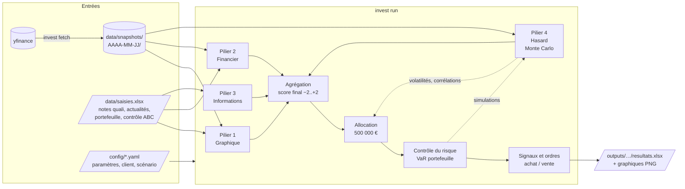

# Conception — Modèle d'aide à l'investissement

> **Statut : PROPOSITION v0.1, à valider par le groupe avant tout développement.**
> Ce document découle du [cahier des charges](cahier-des-charges.md). Les identifiants
> `ENO-xx` / `CLI-xx` / `GRP-xx` renvoient à ses exigences. Les points à trancher sont
> regroupés au [§11](#11-points-à-valider).

---

## 1. Principes directeurs

| Principe | Traduction concrète | Exigence |
|---|---|---|
| **Le client décide, le code s'adapte** | Aucune valeur client dans le code. Toutes ses valeurs sont dans `config/client.yaml` (vide tant qu'inconnue) ; on les complète avec un *scénario* d'hypothèses du groupe, explicitement signalé | GRP-22, GRP-25 |
| **Explicable à l'oral** | Indicateurs codés à la main (pas de TA-Lib ni de pandas-ta) ; fonctions courtes, pures et commentées ; une note de −2 à +2 par indicateur, lisible dans un tableau | GRP-21 |
| **Comparable à ABC Bourse** | Mêmes réglages et mêmes définitions ; onglet de contrôle des écarts avec leurs fiches | GRP-11, GRP-23 |
| **Reproductible** | Instantanés de données datés, graine aléatoire, export de la configuration utilisée dans chaque rapport | GRP-24 |
| **Vérifiable dans Excel** | Monte Carlo reconstruit en formules (ALEA, LOI.NORMALE.INVERSE, table de données) | GRP-10 |
| **Évolutif** | Univers, horizon, indicateurs et grilles se paramètrent ; on peut ajouter un indicateur sans toucher au reste | GRP-26 |

## 2. Vue d'ensemble



**Quatre commandes en ligne de commande** :

| Commande | Rôle |
|---|---|
| `invest fetch` | Télécharge les cours (OHLCV) et les fondamentaux des 5 actions et de leurs pairs, puis les fige dans `data/snapshots/AAAA-MM-JJ/` |
| `invest veille` | Lance les requêtes de dorking (§7.1) et ajoute les nouvelles actualités dans l'onglet `Actualites` de `saisies.xlsx`, avec le statut « à classer » |
| `invest template` | Génère ou met à jour le classeur de saisie `data/saisies.xlsx` (listes déroulantes −2..+2, colonnes de justification) |
| `invest run --snapshot AAAA-MM-JJ --scenario hypotheses_groupe` | Calcule les scores, l'allocation, Monte Carlo et les ordres, puis écrit le rapport Excel |

Pour une réévaluation quotidienne (CLI-03), on relance `fetch` et `veille`, on classe les
nouvelles actualités, puis on met à jour l'onglet
*Portefeuille* avec les positions réellement détenues, puis on lance `run`. Le moteur calcule les
ordres comme la différence entre le portefeuille cible et le portefeuille courant.

## 3. Arborescence proposée

```
Finance/
├── README.md                     # installation, utilisation, déroulé d'une semaine
├── pyproject.toml                # dépendances, commande `invest`
├── config/
│   ├── parametres.yaml           # réglages ABC Bourse + grilles de notation (choix du groupe)
│   ├── univers.yaml              # tickers, noms, pairs sectoriels
│   ├── veille.yaml               # requêtes de dorking, catégories, niveaux de fiabilité des sources
│   ├── client.yaml               # besoins du client : null tant que non fournis (CDC §4)
│   └── scenarios/
│       └── hypotheses_groupe.yaml  # valeurs provisoires du groupe, « NON VALIDÉES »
├── data/
│   ├── saisies.xlsx              # rempli par le groupe
│   └── snapshots/2026-11-30/     # prix.csv, fondamentaux.csv, veille_brute.csv, meta.json
├── outputs/2026-11-30_1805/      # resultats.xlsx, graphiques/*.png, run.json
├── src/invest_model/
│   ├── cli.py                    # point d'entrée des 3 commandes
│   ├── config.py                 # chargement, fusion client + scénario, validation
│   ├── data.py                   # yfinance → instantané ; lecture d'un instantané
│   ├── inputs.py                 # génération et lecture de saisies.xlsx
│   ├── watch.py                  # veille : requêtes dorking → nouvelles lignes « à classer »
│   ├── grids.py                  # conversion valeur → note −2..+2 (générique)
│   ├── indicators/               # fonctions pures : Series pandas → Series
│   │   ├── moving_averages.py
│   │   ├── rsi.py
│   │   ├── macd.py
│   │   ├── bollinger.py
│   │   └── pivots.py
│   ├── pillars/
│   │   ├── technical.py          # pilier 1
│   │   ├── fundamental.py        # pilier 2 (ratios + médiane des pairs)
│   │   ├── news.py               # pilier 3
│   │   └── montecarlo.py         # pilier 4 (GBM, Cholesky, VaR/CVaR)
│   ├── scoring.py                # quanti/quali → pilier → score final
│   ├── allocation.py             # score/volatilité, bornes, actions entières, frais
│   ├── orders.py                 # cible − courant → ordres et signaux
│   └── report/
│       ├── excel.py              # onglets de résultats
│       ├── excel_mc_check.py     # onglets de vérification Monte Carlo en formules
│       └── charts.py             # graphiques PNG (cours + indicateurs, distribution MC)
├── tests/                        # pytest : valeurs calculées à la main, graine fixe
└── docs/
    ├── cahier-des-charges.md
    ├── specifications.md
    ├── conception.md
    └── indicateurs/              # une fiche par indicateur : formule, réglage, leçon ABC citée
        ├── rsi.md  macd.md  bollinger.md  moyennes-mobiles.md  points-pivots.md
        └── ratios-financiers.md
```

**Pourquoi cette structure ?** Chaque fichier correspond à un concept qu'on présente à l'oral (un
indicateur, un pilier, une étape). Les indicateurs sont des **fonctions pures**, sans accès réseau
ni fichier : on peut les tester avec des valeurs calculées à la main. Les piliers assemblent les
indicateurs, et `scoring.py` assemble les piliers. On peut confier un pilier à chaque membre du
groupe.

## 4. Configuration : séparer client, groupe et technique

Trois niveaux, du plus stable au plus variable :

| Fichier | Contenu | Qui le modifie |
|---|---|---|
| `parametres.yaml` | Réglages des indicateurs (RSI 14, MM 20/50/100, Bollinger 20 / 2σ, MACD 12/26/9), seuils des grilles, nombre de simulations, graine | Le groupe, une fois validé |
| `client.yaml` | Une clé par question du CDC §4 : perte maximale, cash autorisé, vente à découvert, frais, bornes de poids, dates… **toutes à `null`** au départ | Le groupe, **uniquement avec une réponse du client** |
| `scenarios/*.yaml` | Valeurs provisoires des clés client encore à `null`, poids entre piliers et entre quanti et quali | Le groupe (hypothèses de travail) |

**Règle de fusion** : `client.yaml` l'emporte toujours sur le scénario. Si une clé reste à `null`
dans les deux fichiers, l'exécution s'arrête avec un message clair (« `client.cash_max` non
renseigné : compléter client.yaml ou le scénario »). Chaque valeur provenant d'un scénario est
listée dans l'onglet *Paramètres* du rapport, et l'onglet *Synthèse* affiche un bandeau
« Résultats fondés sur des hypothèses du groupe non validées par le client : … ».

Extrait illustratif de `client.yaml` (structure seulement, aucune valeur) :

```yaml
# Besoins du client — voir docs/cahier-des-charges.md §4.
# Ne renseigner une valeur QUE sur réponse du professeur (noter la référence CLI-xx).
repartition:            # CLI-05
  cash_min: null        # part minimale de cash (0–1)
  cash_max: null
  poids_min: null       # par action
  poids_max: null
regles:                 # CLI-04
  vente_decouvert: null # true / false
  actions_entieres: null
frais:                  # CLI-06
  pct: null
  fixe: null
```

## 5. Pilier 1 — Graphique

### 5.1 Indicateurs et réglages

| Outil | Réglage | Calcul | Source ABC Bourse |
|---|---|---|---|
| Moyennes mobiles | MM **simples** 20, 50, 100 jours | Moyenne des N dernières clôtures | [Les moyennes mobiles](https://www.abcbourse.com/apprendre/11_lecon2.html) ; réglages 20/50/100 de la fiche [Analyse et conseil](https://www.abcbourse.com/analyses/conseil/RMSp) |
| RSI | 14 jours, lissage de Wilder | 100 − 100 / (1 + moyenne des hausses / moyenne des baisses) | [Le RSI](https://www.abcbourse.com/apprendre/11_lecon7_1.html) |
| MACD | EMA 12 − EMA 26 ; signal = EMA 9 de la MACD ; histogramme = MACD − signal | Moyennes mobiles exponentielles | [La MACD](https://www.abcbourse.com/apprendre/11_lecon3.html) |
| Bandes de Bollinger | MM20 ± 2 écarts-types (sur 20 séances) | Bande haute, bande basse et %B = (C − basse) / (haute − basse) | [Les Bandes de Bollinger](https://www.abcbourse.com/apprendre/11_lecon4.html) |
| Points pivots | Méthode standard, quotidienne (comme l'outil ABC) et hebdomadaire | P = (H+B+C)/3 ; S1 = 2P − H ; S2 = P − (H − B) ; R1 = 2P − B ; R2 = P + (H − B) | [Les Points pivots](https://www.abcbourse.com/apprendre/11_pivots.html), [outil Points pivots](https://www.abcbourse.com/analyses/pivots) |

Ce que les leçons ne disent pas, et que nous fixons nous-mêmes (choix documentés dans
`docs/indicateurs/`) :
- **RSI** : la leçon ne donne la formule qu'en image. Nous prenons le lissage de Wilder (la
  définition d'origine, et le RSI 14 jours que cite la leçon est celui de Wilder). On vérifie
  ensuite notre valeur contre celle de la fiche ABC, par exemple « RSI 14 jours = 37,5 % »
  sur Hermès.
- **Bollinger** : écart-type de population (division par N), comme dans la définition de John
  Bollinger.
- **Pivots** : à la clôture du jour *t*, on compare le cours aux pivots calculés sur *t−1*, ceux
  qui étaient en vigueur pendant la séance *t*. Comparer la clôture aux pivots calculés sur la
  même séance serait circulaire. Même logique pour les pivots hebdomadaires, calculés sur la
  semaine précédente.
- **MACD** : la leçon ne valide un croisement que si MACD et signal sont restés du même côté
  pendant **au moins 14 séances** avant. Cette règle est reprise, et le nombre de séances est
  paramétrable.

### 5.2 Notation quantitative (−2..+2) — grilles proposées, toutes paramétrables

| Indicateur | +2 | +1 | 0 | −1 | −2 |
|---|---|---|---|---|---|
| RSI 14 | ≤ 30 (survente) | 30–40 | 40–60 | 60–70 | ≥ 70 (surachat) |
| MACD | Croisement haussier validé depuis ≤ k séances | MACD > signal | — | MACD < signal | Croisement baissier validé depuis ≤ k séances |
| Bollinger | Réintégration par la bande basse (retournement) | Sortie par le haut (continuation) | À l'intérieur des bandes | Sortie par le bas | Réintégration par la bande haute |
| MM 20/50/100 | Cours > les 3 MM | Cours > 2 MM | — | Cours > 1 MM | Cours < les 3 MM |
| Pivots (quotidien et hebdo, moyenne pondérée) | C > R1 | P < C ≤ R1 | — | S1 ≤ C < P | C < S1 |

Les seuils 30 et 70 du RSI, la règle de croisement de la MACD et les règles de sortie et de
réintégration des Bollinger viennent des leçons ABC. Les autres bornes sont des propositions du
groupe.

Le **quantitatif du pilier** est la moyenne pondérée des 5 notes, avec des poids paramétrables.
Si un indicateur ne peut pas être calculé, il est exclu, les poids des autres sont renormalisés et
l'exclusion est signalée dans le *Journal*.

### 5.3 Qualitatif

L'onglet `Graphique` de `saisies.xlsx` contient une ligne par action et par critère : *Tendance*,
*Figures chartistes*, *Supports et résistances visuels*. Pour chaque ligne : une note de −2 à +2
(liste déroulante) et une **justification obligatoire** (une note sans justification est refusée
à la lecture). La liste des critères est paramétrable.

## 6. Pilier 2 — Financier

### 6.1 Ratios et références

| Ratio | Définition retenue | Source |
|---|---|---|
| PER | Cours / BNPA | ABC [Leçon 9 — PER et PEG](https://www.abcbourse.com/apprendre/12_lecon_af_9_partie2.html) |
| PEG | PER / taux de croissance attendu des bénéfices (en %) | Même leçon : < 1 = sous-évalué |
| Rendement du dividende | Dividende / cours | ABC [Les dividendes](https://www.abcbourse.com/apprendre/1_les_dividendes1.html), [Leçon 9 partie 3](https://www.abcbourse.com/apprendre/12_lecon_af_9_partie3.html) |
| ROE | Résultat net / capitaux propres | Définition standard. **Absente des leçons ABC**, mais affichée sur les fiches (critère « ROE > 10 % ») |
| Dette nette / EBITDA | (Dettes financières − trésorerie) / EBITDA | Définition standard. **Absente des leçons ABC.** Les fiches affichent plutôt le « ratio d'endettement net » (dette nette / capitaux propres) : nous calculons aussi celui-ci pour pouvoir comparer |
| Marge | Marge nette (RN / CA) et marge opérationnelle | Définition standard. Les fiches affichent la « marge opérationnelle courante » |

**Référence secteur** : la médiane des ratios de **pairs configurables** (dans `univers.yaml`),
téléchargés avec yfinance. Le groupe peut **remplacer** une valeur dans l'onglet
`Secteur_Override` de `saisies.xlsx`, avec la source et la date (par exemple « PER secteur 28,97,
fiche ABC du 24/11 »). Pairs proposés, à valider :

| Action | Pairs proposés |
|---|---|
| Hermès | LVMH (MC.PA), Kering (KER.PA), Richemont (CFR.SW), Moncler (MONC.MI) |
| Air Liquide | Linde (LIN), Air Products (APD) |
| Capgemini | Sopra Steria (SOP.PA), Alten (ATE.PA), Accenture (ACN) |
| TotalEnergies | Shell (SHEL.L), BP (BP.L), Eni (ENI.MI), Repsol (REP.MC) |
| Dassault Systèmes | SAP (SAP.DE), Autodesk (ADSK), PTC (PTC) |

### 6.2 Notation

Une grille générique est appliquée à chaque ratio. On compare soit le **ratio relatif** (valeur /
médiane du secteur), soit la valeur absolue, au choix par ratio. On précise aussi le sens : pour
le PER, plus bas est mieux ; pour le ROE, plus haut est mieux. Exemple pour le PER relatif : ≤ 0,8
→ +2 ; ≤ 0,95 → +1 ; ≤ 1,05 → 0 ; ≤ 1,2 → −1 ; au-delà → −2. Une dette nette négative
(trésorerie nette) vaut +2.

**Qualitatif** : critères *Solidité du modèle économique* et *Position sectorielle*, chacun noté
de −2 à +2 avec une justification.

**Risque sur les données** : yfinance renvoie souvent `None` pour le PEG des valeurs européennes,
et le format de `dividendYield` a changé selon les versions. Nous calculons le PEG nous-mêmes
(PER / croissance attendue) si le champ est absent. Chaque ratio affiché indique sa provenance :
`yfinance`, `calculé` ou `saisi`.

## 7. Pilier 3 — Informations

L'onglet `Actualites` de `saisies.xlsx` a une ligne par nouvelle : date, action, titre, source,
URL, **catégorie** (résultats, communiqué officiel, macro, secteur), **note** de −2 à +2 (le
signe donne le sens, la valeur absolue l'importance), **fiabilité** de 1 à 3 et justification.

- **Quantitatif (comptage et classement)** : sur une fenêtre de N jours, on calcule
  `net = (Σ c·n⁺ − Σ c·n⁻) / (Σ c·n⁺ + Σ c·n⁻)`, où c est le poids de la catégorie (paramétrable)
  et n⁺, n⁻ le nombre de nouvelles positives et négatives. `net` est dans [−1, 1] ; la grille le
  ramène dans −2..+2. Sans aucune nouvelle, la note vaut 0.
- **Qualitatif (importance et fiabilité)** : la moyenne des notes du groupe pondérée par la
  fiabilité, `Σ note·fiab / Σ fiab`, qui est déjà dans −2..+2.
- Seules les nouvelles **classées** (note renseignée) comptent. Les lignes « à classer »
  produites par la veille sont ignorées et signalées dans le *Journal*.

### 7.1 Veille automatique par dorking (`invest veille`)

**Objectif** : trouver des informations fraîches sans tout chercher à la main. Le script collecte
les nouvelles et les pré-remplit ; **la notation reste faite par le groupe**, puisque
l'importance et la fiabilité relèvent du jugement (GRP-05).

**Sources** (par ordre de préférence) :

| Source | Accès | Usage |
|---|---|---|
| Google News RSS (`news.google.com/rss/search`) | Gratuit, sans clé. Accepte les opérateurs `"…"`, `OR`, `-`, `site:`, `intitle:` et `when:7d` (testé le 24/11/2026) | Source principale : presse et actualités récentes |
| API Google Programmable Search (JSON) | Clé gratuite, 100 requêtes par jour | Optionnelle : dorks sur les sites officiels (`site:hermes-finance.com filetype:pdf`, `site:amf-france.org …`) |
| Flux RSS des sites investisseurs des émetteurs (quand ils existent) | Gratuit | Communiqués officiels |

Pas d'interrogation automatisée de la page de recherche Google classique : elle bloque les robots
(page anti-robot constatée), et ses conditions d'utilisation l'interdisent.

**Requêtes paramétrables** dans `config/veille.yaml`, un modèle par catégorie, appliqué à chaque
action :

```yaml
fenetre: "when:7d"
modeles:
  resultats:   '"{nom}" (résultats OR "chiffre d''affaires" OR guidance OR trimestre)'
  communique:  '"{nom}" (communiqué OR annonce OR acquisition OR dividende)'
  secteur:     '{secteur_mots_cles} -"{nom}"'
  macro:       '(BCE OR inflation OR "taux directeurs") CAC 40'
  officiel:    'site:{site_ir} OR site:amf-france.org "{nom}"'   # API Programmable Search uniquement
fiabilite_par_domaine:        # SUGGESTION pré-remplie, le groupe confirme
  3: [amf-france.org, euronext.com, "{site_ir}"]
  2: [lesechos.fr, investir.lesechos.fr, boursier.com, zonebourse.com, abcbourse.com, reuters.com]
  1: ["*"]                     # tous les autres domaines
```

**Traitement** :
1. Pour chaque action et chaque modèle, on exécute la requête, avec une pause entre les appels
   (une vingtaine de requêtes au total).
2. On normalise les résultats : date, titre, source, domaine, URL et requête d'origine.
3. On **dédoublonne** par rapport aux lignes déjà présentes, selon l'URL ou le titre normalisé.
   Relancer le script n'ajoute donc que les vraies nouveautés.
4. On **ajoute les nouvelles lignes** à l'onglet `Actualites` : statut « à classer », catégorie
   pré-remplie selon le modèle de requête, fiabilité suggérée selon le domaine. Note et
   justification restent vides. Les lignes déjà classées par le groupe ne sont jamais modifiées.
5. On archive le résultat brut dans `snapshots/AAAA-MM-JJ/veille_brute.csv`, pour pouvoir
   reproduire la collecte (GRP-24).

**Limites connues** : les liens Google News sont des redirections (on garde aussi le nom de la
source) ; un même article peut sortir pour plusieurs actions ; le flux renvoie au maximum une
centaine de résultats par requête.

## 8. Pilier 4 — Hasard (Monte Carlo)

### 8.1 Modèle

Les rendements logarithmiques quotidiens sont estimés sur une fenêtre historique paramétrable :
moyenne *m*, écart-type σ, et matrice de corrélation ρ.

Mouvement brownien géométrique, au pas d'une séance :

  S(t+1) = S(t) · exp( m + σ · ε(t) ), avec ε = L · Z, où Z ~ N(0, I) et L L' = ρ (Cholesky)

Ici *m* est la moyenne des log-rendements, ce qui équivaut au terme μ − σ²/2 de la formule
usuelle ; le document l'explique pour éviter de soustraire σ²/2 deux fois. Un interrupteur
`correlations: true/false` remplace L par la matrice identité.

### 8.2 Sorties

- Pour le **portefeuille alloué** : la distribution de la valeur à l'horizon, l'espérance, les
  quantiles 5 / 25 / 50 / 75 / 95 %, la **VaR** et la **CVaR** au niveau de confiance choisi, et
  la probabilité de perte. Graphique en éventail des trajectoires et histogramme du P&L.
- Pour **chaque action** : la volatilité sur l'horizon (utilisée par l'allocation) et un score.

### 8.3 Rôle dans le score — proposition

Le pilier 4 n'a pas de qualitatif (GRP-02). Nous proposons un double rôle :
1. **Un score quantitatif** par action, issu de la grille appliquée à P(rendement à l'horizon > 0).
   Son poids entre piliers est paramétrable et peut être mis à 0.
2. **Le contrôle du risque** : la volatilité entre dans l'allocation (§9). Si la VaR du
   portefeuille dépasse la perte maximale du client (CLI-02), l'exposition est réduite au profit
   du cash, dans la limite de ce que le client autorise (CLI-05).

### 8.4 Vérification dans Excel (GRP-10)

Deux onglets dans `resultats.xlsx`, avec des formules en clair :

| Onglet | Principe | Ce qu'on vérifie |
|---|---|---|
| `MC_Verif_Exacte` | On reprend les tirages Z de Python (un échantillon de quelques centaines de lignes). Les formules recalculent S_T, V_T et le P&L | Égalité **exacte** avec les résultats Python : la formule est bien implémentée |
| `MC_Verif_ALEA` | Une ligne de simulation avec `=LOI.NORMALE.INVERSE(ALEA();0;1)` par action, corrélation par `PRODUITMAT(L;Z)`, puis une **table de données** de N lignes pour répéter le tirage. Statistiques : MOYENNE, ECARTYPE, CENTILE (VaR) | Accord **statistique** avec Python (aux erreurs d'échantillonnage près, les tirages étant différents) |

La matrice L de Cholesky est exportée en valeurs, avec une cellule de contrôle
`PRODUITMAT(L;TRANSPOSE(L))` qui doit retrouver ρ. La simulation Excel se fait **directement à
l'horizon** : S_T = S₀·exp(5m + σ√5·ε). Pour la valeur finale, c'est équivalent en loi aux
5 pas quotidiens, et bien plus simple à vérifier.

Notes techniques :
- openpyxl écrit les noms anglais des fonctions (`NORMINV`, `RAND`, `MMULT`). Excel en français
  les affiche `LOI.NORMALE.INVERSE`, `ALEA` et `PRODUITMAT`.
- La table de données sera écrite avec `DataTableFormula` d'openpyxl. Si elle ne se calcule pas
  correctement à l'ouverture, on prévoit un repli : N lignes de formules recopiées (même
  principe), plus la procédure manuelle *Données → Analyse de scénarios → Table de données*.

## 9. Agrégation, allocation et ordres

### 9.1 Scores

Pour chaque action *i* et chaque pilier *p* parmi Graphique, Financier et Informations :

  S_p,i = λ_p · Quanti_p,i + (1 − λ_p) · Quali_p,i, où λ_p ∈ [0, 1] est paramétrable

Le score du pilier Hasard est S_H,i = Quanti_H,i. Le score final est la moyenne pondérée des
piliers :

  **S_i = Σ_p W_p · S_p,i / Σ_p W_p**, qui reste dans [−2, +2]

### 9.2 Allocation (score ajusté du risque)

1. **Éligibilité** : une action est éligible à l'achat si S_i > seuil_achat. Si le client
   autorise la vente à découvert, elle peut être vendue à découvert si S_i < −seuil_vente.
2. **Poids bruts** : wᵢ ∝ Sᵢ / σᵢ (σ est la volatilité à l'horizon issue du pilier 4).
3. **Normalisation** à la part investie (1 − cash), puis application des bornes min et max par
   remplissage itératif : on plafonne, on redistribue l'excédent, et on recommence.
4. **Contrôle VaR** par Monte Carlo (§8.3), avec réduction de l'exposition si nécessaire.
5. **Passage en nombre d'actions** si le client l'impose. On arrondit à l'unité inférieure, puis
   le reliquat de cash est réparti par ordre de score.
6. **Frais** déduits selon `client.frais` (pourcentage, montant fixe, minimum, TTF).

### 9.3 Signaux et ordres

- **Signal** par action, selon S_i : Achat fort, Achat, Neutre, Vente, Vente forte (seuils
  paramétrables).
- **Ordre** = quantité cible − quantité détenue (onglet *Portefeuille*) : ACHAT, VENTE ou
  CONSERVER. Un seuil minimal évite les micro-ordres dont les frais dépasseraient l'intérêt.
- Chaque ordre est accompagné de sa **justification automatique** : les trois notes qui y
  contribuent le plus, et la justification qualitative saisie par le groupe.

## 10. Rapport Excel `resultats.xlsx`

| Onglet | Contenu |
|---|---|
| Synthèse | Bandeau de statut (hypothèses non validées), allocation en € et en %, ordres, signaux, VaR |
| Scores | Matrice action × pilier : quanti, quali, pondéré, score final |
| Graphique / Financier / Informations | Valeur brute de chaque indicateur ou ratio → note, avec sa provenance |
| Monte Carlo | Paramètres (m, σ, ρ), statistiques, histogramme, éventail des trajectoires |
| MC_Verif_Exacte / MC_Verif_ALEA | Vérification en formules (§8.4) |
| Contrôle_ABC | Valeurs relevées par le groupe sur les fiches ABC (onglet de saisie) comparées aux nôtres, avec l'écart |
| Paramètres | Configuration complète utilisée, origine de chaque valeur (client ou scénario), instantané de données, version du code, graine |
| Journal | Avertissements : donnée manquante, ratio saisi à la main, indicateur exclu… |

**Contrôle ABC Bourse** : le groupe relève sur la fiche *Analyse et conseil*, **le jour de
l'instantané**, les valeurs affichées : RSI 14 jours, position par rapport aux MM 20/50/100 et aux
bandes de Bollinger, MACD par rapport à son signal, PER, PER secteur, ROE, endettement net. Pas de
récupération automatique : le site refuse les accès automatisés, et une saisie datée est plus
traçable.

## 11. Points à valider

1. **Arborescence et commandes** (§2, §3) : est-ce qu'elles vous conviennent ?
2. **Configuration à trois niveaux** (§4) : les valeurs client restent à `null`, et un scénario
   « hypotheses_groupe » sert à faire tourner le modèle en attendant les réponses du professeur.
3. **Grilles de notation** (§5.2, §6.2) : les bornes proposées serviront de base. Le groupe
   pourra les ajuster dans `parametres.yaml`.
4. **Ratios absents des leçons ABC** (ROE, dette nette / EBITDA, marge) : on prend les définitions
   standards, et on ajoute le ratio d'endettement net des fiches pour pouvoir comparer.
5. **Pairs sectoriels** (§6.1) : la liste est-elle bonne ?
6. **Pilier Informations** (§7) : une note de −2 à +2 par nouvelle (le sens et l'importance), plus
   une fiabilité de 1 à 3.
7. **Rôle du pilier Hasard** (§8.3) : un score quantitatif (poids réglable, éventuellement 0) et
   le contrôle du risque.
8. **Vérification Excel** (§8.4) : un onglet exact et un onglet ALEA avec table de données.
9. **Veille par dorking** (§7.1) : Google News RSS comme source principale, et l'API
    Programmable Search en option pour les dorks `site:` et `filetype:`. Les lignes sont
    pré-remplies « à classer », la notation reste humaine.
10. **Pile technique** : Python 3.11+, pandas, numpy, yfinance, openpyxl, PyYAML, matplotlib,
   pytest. Pas de bibliothèque d'analyse technique toute faite.

Après validation : rédaction de `specifications.md`, avec des exigences numérotées `SPE-xx` qui
renvoient aux `CLI` et `GRP`, puis développement pilier par pilier, avec les tests.
